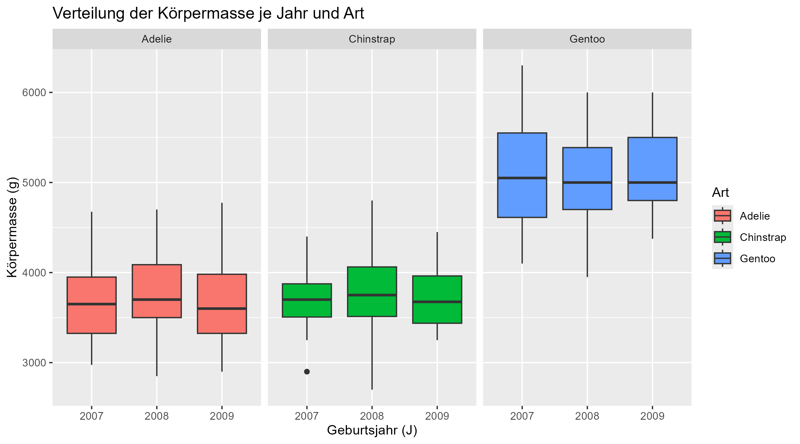

# 2026-10-13 ggplots – Demo nachbauen und ergänzen

Name: Florian Benes · 4AHWIT (x)

Angabe: Demo aus [GRG-PMM/4ahwit-x/2026-10-13_ggplots/demo.R](https://github.com/georgernstgraf/GRG-PMM/blob/main/4ahwit-x/2026-10-13_ggplots/demo.R)
(`year` gegen `body_mass_g` mit `geom_smooth()`) nachbauen und sinnvoll ergänzen.

## Dateien

| Datei | Inhalt |
|---|---|
| `2026-10-13_ggplots.Rproj` | RStudio-Projekt |
| `ggplots.R` | Demo + 3 Ergänzungen, speichert alle Plots als PNG |
| `*.png` | die erzeugten Plots |
| `konsolenausgabe.txt` | vollständige RStudio-Konsolenausgabe eines Durchlaufs |
| `eingaben_konsole.Rhistory` | die Befehle, die ich in der Console eingegeben habe (Beleg für den Testlauf) |

## 1. Demo (nachgebaut)

`year` auf der x-Achse, `body_mass_g` auf der y-Achse, `geom_smooth()`,
Achsentitel „Geburtsjahr (J)“ und „Körpermasse (g)“.

## 2. Ergänzungen und warum

| Ergänzung | Warum sinnvoll |
|---|---|
| `geom_jitter()` + Linie | Die Linie allein versteckt, wie stark die Einzelwerte streuen. `year` hat nur 3 Werte → Jitter verhindert, dass Punkte übereinander liegen. Statt loess eine gerade Linie (`method = "lm"`), weil loess bei nur 3 x-Werten Warnungen liefert. |
| `color = species` + `geom_smooth(method = "lm")` | Die Arten unterscheiden sich stark im Gewicht; eine gemeinsame Linie mischt sie. Bei nur 3 x-Werten ist eine gerade Linie passender. |
| Boxplot + `facet_wrap(~ species)` | Zeigt Median und Streuung je Jahr und Art auf einen Blick. |

## Interpretation

Über 2007–2009 bleibt die Körpermasse ziemlich konstant, ein klarer Trend
ist nicht zu sehen: Die loess-Kurve der Demo schwankt nur zwischen ca. 4100
und 4270 g, und das Unsicherheitsband ist so breit, dass das kein echter
Unterschied ist. Viel größer sind die Unterschiede zwischen den Arten:
Gentoo liegt im Median bei ca. 5000 g, Adelie und Chinstrap bei ca. 3700 g –
und das in jedem Jahr. Mit nur drei Jahren lässt sich ohnehin kein
langfristiger Trend ableiten.

**Warnungen:** Die Demo ist absichtlich original gelassen. Ihre loess-Glättung
meldet bei nur 3 x-Werten Warnungen, und 2 Pinguine ohne Körpermasse werden
entfernt („Removed 2 rows“). In den Ergänzungen werden diese 2 Pinguine
vorher mit `subset()` herausgefiltert und eine gerade Linie verwendet –
dort gibt es keine Warnungen mehr.
