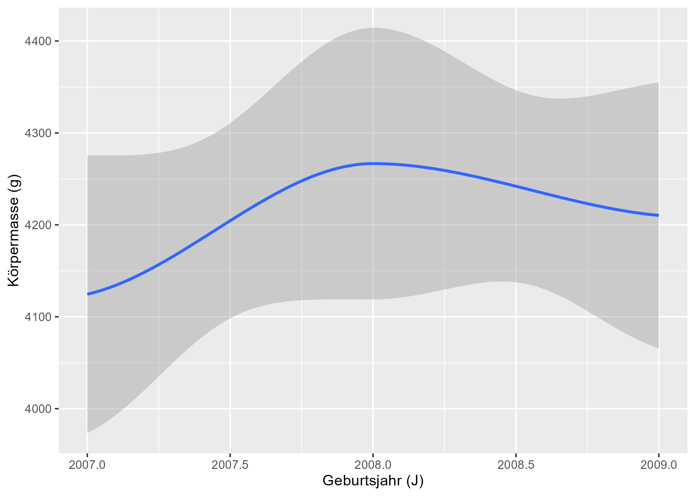
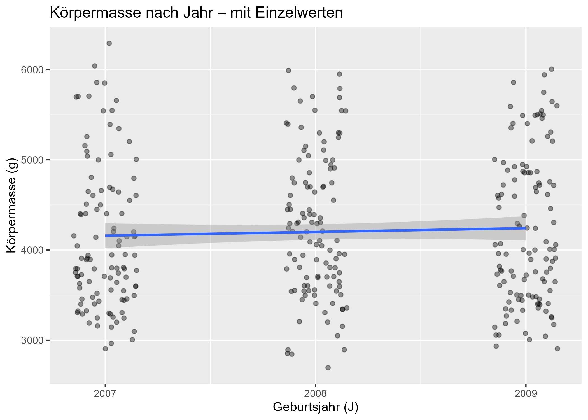
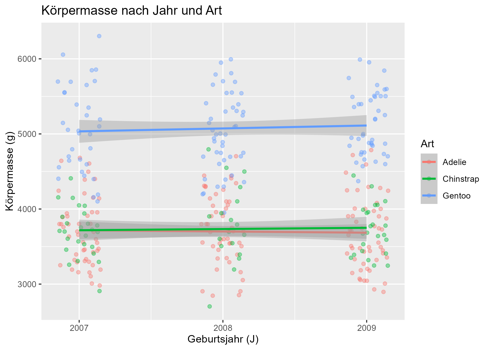

# 2026-10-13 ggplots – Demo nachbauen und ergänzen

Name: Florian Benes · 4AHWIT (x)

Angabe: Demo aus [GRG-PMM/4ahwit-x/2026-10-13_ggplots/demo.R](https://github.com/georgernstgraf/GRG-PMM/blob/main/4ahwit-x/2026-10-13_ggplots/demo.R)
(`year` gegen `body_mass_g` mit `geom_smooth()`) nachbauen und sinnvoll ergänzen.

## Dateien

| Datei | Inhalt |
|---|---|
| `2026-10-13_ggplots.Rproj` | RStudio-Projekt |
| `ggplots.R` | Demo + 3 Ergänzungen, speichert alle Plots als PNG |
| `*.png` | die erzeugten Plots |
| `konsolenausgabe.txt` | vollständige RStudio-Konsolenausgabe eines Durchlaufs |

## 1. Demo (nachgebaut)

`year` auf der x-Achse, `body_mass_g` auf der y-Achse, `geom_smooth()`,
Achsentitel „Geburtsjahr (J)“ und „Körpermasse (g)“.

## 2. Ergänzungen und warum

| Ergänzung | Warum sinnvoll |
|---|---|
| `geom_jitter()` + Linie | Die Linie allein versteckt, wie stark die Einzelwerte streuen. `year` hat nur 3 Werte → Jitter verhindert, dass Punkte übereinander liegen. |
| `color = species` + `geom_smooth(method = "lm")` | Die Arten unterscheiden sich stark im Gewicht; eine gemeinsame Linie mischt sie. Bei nur 3 x-Werten ist eine gerade Linie passender. |
| Boxplot + `facet_wrap(~ species)` | Zeigt Median und Streuung je Jahr und Art auf einen Blick. |

## Interpretation

Über 2007–2009 bleibt die Körpermasse ziemlich konstant, ein klarer Trend
ist nicht zu sehen. Die Unterschiede zwischen den Arten (Gentoo deutlich
schwerer) sind viel größer als die zwischen den Jahren. Mit nur drei
Jahren lässt sich ohnehin kein langfristiger Trend ableiten.
